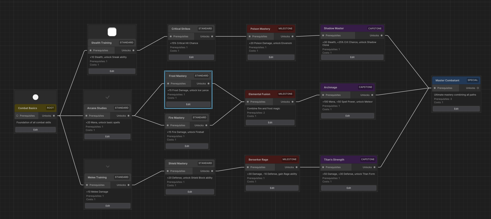

# Unity Skill Tree Package

A comprehensive, plug-and-play skill tree system for Unity 2021.3+ featuring visual node editing, runtime UI, save/load persistence, and VContainer integration.



## Features

- ✅ **Flexible Graph Structure** - Any node can connect to any other, supports complex prerequisites
- ✅ **Visual Node Editor** - Professional GraphView-based editor for designers
- ✅ **Runtime UI System** - Player-facing UI with animations and interactive elements
- ✅ **Save/Load Persistence** - Versioned, pluggable save system with auto-backups
- ✅ **VContainer Integration** - First-class dependency injection support
- ✅ **Extension System** - Fully customizable behaviors, requirements, costs, and visuals
- ✅ **Sample Content** - Three complete example skill trees (RPG, Tech, Weapon Upgrades)
- ✅ **Event-Driven Architecture** - Decoupled, reactive programming support

## Quick Start

### 1. Create a Skill Tree Asset

```
Right-click in Project → Create > Skill Tree > New Skill Tree
```

Or try one of the examples:
- `Tools > Skill Tree > Create Example > RPG Skill Tree`
- `Tools > Skill Tree > Create Example > Tech Tree`
- `Tools > Skill Tree > Create Example > Weapon Upgrades Tree`

### 2. Basic Usage

**Manual Setup (No DI)**:
```csharp
var eventBus = new SkillTreeEventBus();
var manager = new SkillTreeManager(skillTreeGraph, eventBus);

manager.Subscribe<SkillUnlockedEvent>(evt => Debug.Log($"Unlocked: {evt.Node.DisplayName}"));
manager.SetResource("SkillPoints", 10);
manager.UnlockNode("skill_fireball");
```

**VContainer Integration**:
```csharp
[Inject] private ISkillTreeManager _skillTreeManager;

_skillTreeManager.SetResource("SkillPoints", 10);
_skillTreeManager.UnlockNode("skill_fireball");
```

> **See full examples**: [API_Reference.md](Documentation~/API_Reference.md#runtime-logic)

### 3. Save & Load

```csharp
var saveSystem = new JsonSaveSystem<SkillTreeSaveData>();

// Save
var saveData = new SkillTreeSaveData { SkillTreeId = "player_skills" };
saveData.AddUnlockedNode("skill_fireball");
saveData.SetResource("SkillPoints", 10f);
saveSystem.Save("player_save", saveData);

// Load
var loaded = saveSystem.Load("player_save");
bool hasFireball = loaded.IsNodeUnlocked("skill_fireball");
```

Supports async operations, auto-backups, and custom configurations.

> **See full documentation**: [API_Reference.md](Documentation~/API_Reference.md#save-system)

## Core Concepts

### Data Model
- **SkillNode**: Individual skill with ID, display name, icon, requirements, costs, and custom data
- **SkillConnection**: Relationships between nodes (Prerequisite, Soft, Exclusive, Bidirectional)
- **SkillTreeGraph**: ScriptableObject container managing nodes, connections, and validation

### Node Types
**Root** (no prerequisites) → **Standard** → **Milestone** → **Capstone**

### Validation
The system automatically detects duplicate IDs, circular dependencies, orphan nodes, and invalid references.

> **Full API reference**: [API_Reference.md](Documentation~/API_Reference.md)

## Extension System

The package provides four extension points for customization:

### 1. ISkillNodeExtension
Execute custom logic when nodes are unlocked (grant abilities, modify stats, unlock content):
```csharp
public class AbilityUnlockExtension : ISkillNodeExtension
{
    public string NodeTypeId => "AbilityUnlock";

    public void OnNodeUnlocked(SkillNode node, ISkillTreeState state)
    {
        string abilityId = node.CustomData["AbilityId"];
        PlayerAbilities.Unlock(abilityId);
    }
}

SkillTreeExtensionRegistry.Instance.RegisterNodeExtension(new AbilityUnlockExtension());
```

### 2. IConditionEvaluator
Add custom requirements (level checks, quest completion, achievements):
```csharp
public class QuestRequirementEvaluator : IConditionEvaluator
{
    public string ConditionType => "QuestComplete";

    public bool Evaluate(SkillRequirement requirement, ISkillTreeState state, object context = null)
    {
        return QuestManager.IsQuestComplete(requirement.Parameters["QuestId"]);
    }
}
```

### 3. ISkillCostProvider
Custom resource systems (multi-currency, items, experience):
```csharp
public class ItemCostProvider : ISkillCostProvider
{
    public string CostType => "ItemCost";

    public bool CanAfford(SkillCost cost, ISkillTreeState state, object context = null)
    {
        string itemId = cost.CustomData["ItemId"];
        return Inventory.HasItem(itemId, int.Parse(cost.CustomData["Amount"]));
    }
}
```

### 4. ISkillVisualProvider
Customize node appearance (colors, effects, animations):
```csharp
public class ClassVisualProvider : ISkillVisualProvider
{
    public void CustomizeNodeVisual(GameObject nodeUI, SkillNode node, SkillNodeVisualState state)
    {
        if (node.CustomData.TryGetValue("Class", out string className))
            nodeUI.GetComponent<Image>().color = GetClassColor(className);
    }
}
```

> **Complete extension guide**: [Extension_Guide.md](Documentation~/Extension_Guide.md)

## Sample Skill Trees

The package includes three fully functional example trees:

1. **RPG Skill Tree** - Three class paths (Warrior, Mage, Rogue) with progressive tiers culminating in a hybrid ultimate skill
2. **Technology Tree** - Civilization-style tech progression across historical eras with parallel research paths
3. **Weapon Upgrades Tree** - Five weapon types with four upgrade tiers and multi-currency costs

Create via: `Tools > Skill Tree > Create Example > [Tree Type]`

## Documentation

- **[API Reference](Documentation~/API_Reference.md)** - Complete interface documentation, data models, and runtime logic
- **[Extension Guide](Documentation~/Extension_Guide.md)** - Detailed guide for creating custom extensions with examples
- **[Samples](Samples~/)** - Working examples and demo scenes

## Dependencies

- Unity 2021.3+
- TextMeshPro (UI)
- PrimeTween (animations)
- VContainer (optional, DI)

---

**Package Version**: 0.6.0

Built with extensibility-first architecture following Unity best practices and modern C# patterns.